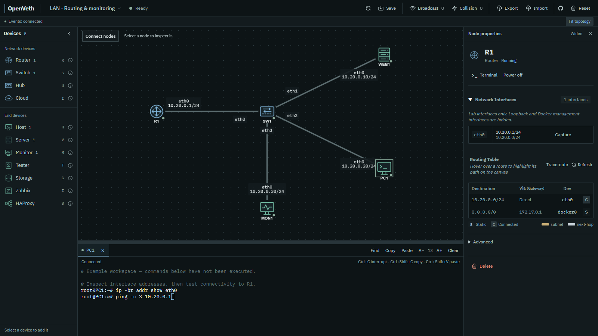

# OpenVeth

OpenVeth is a network lab environment you control from your browser. Build topologies, configure Linux nodes through integrated terminals, and inspect the packets moving between them.

Nodes run in Docker containers. Links use Linux network namespaces, veth pairs, and bridges, so you work with real networking tools and services.



*A LAN lab connecting a router, switch, web server, client, and monitor. Inspect interface addresses and routes alongside the topology, with a node terminal open below. Screenshot uses example data; terminal commands are shown for illustration, not as executed connectivity tests.*

[Hands-on labs](https://rarielvillalobos.github.io/open-veth-labs/) · [Usage guide](docs/usage.md) · [Development](docs/development.md) · [License](LICENSE)

## Quick start

### Requirements

- **Linux**, or **Windows with Docker Desktop using its WSL2 backend**. Network namespace operations require a Linux kernel.
- Docker running Linux containers and Docker Compose v2.
- Git to clone the repository.
- On Linux: Make, Bash, `curl`, and `ss` from `iproute2`.
- On Windows: Windows PowerShell 5.1, used by the launcher.

Go and Node.js are only needed for native development. The first startup downloads node images and builds the application images, so it requires internet access and can take several minutes.

### Linux

```bash
git clone https://github.com/RArielVillalobos/open-veth.git
cd open-veth
make up
```

### Windows

Start Docker Desktop and ensure its WSL2 backend is enabled. Then run:

```powershell
git clone https://github.com/RArielVillalobos/open-veth.git
cd open-veth
.\start.bat
```

You can also double-click `start.bat` after cloning.

Both launchers reuse local node images, download missing ones, and attempt a local build if a download fails. They select available ports and wait for the API, frontend, and API proxy before reporting readiness.

**Open the URL printed by the launcher.** The frontend prefers port 80, but it may receive a different port when that port is occupied. Do not assume that `http://localhost` is always the assigned address.

```bash
make status    # Container status and published ports
make logs      # Service logs
make down      # Stop the application stack
```

For startup options and troubleshooting, see the [usage guide](docs/usage.md#startup-and-troubleshooting).

## Your first laboratory

1. Open **New Topology** if the startup dialog is shown.
2. Add a **Router** named `R1` and a **Host** named `PC1` from the device list.
3. Select **Connect nodes**, then select `R1` and `PC1`. Press Escape to leave connection mode.
4. Select a node to inspect it, then open **Terminal**. On a fresh topology, the first lab interface is `eth0`.

On `R1`:

```bash
ip addr add 10.0.0.1/24 dev eth0
ip link set eth0 up
```

On `PC1`:

```bash
ip addr add 10.0.0.2/24 dev eth0
ip link set eth0 up
ping -c 3 10.0.0.1
```

Select either node and use **Capture** beside `eth0` to inspect traffic. Run the ping again to see the packets. Use **Save** to save network settings and create filesystem snapshots of running nodes.

The terminal supports multiple node tabs, output search (`Ctrl+Shift+F`), font size controls, and reconnection. `Ctrl+C` interrupts a process; `Ctrl+Shift+C` copies selected text and `Ctrl+Shift+V` pastes, subject to browser clipboard permissions. Reconnecting opens a new shell connection and keeps the previous output in the panel.

## What you can practice

- **Networking:** addressing, ARP, subnetting, static routing, DHCP, DNS, NAT, and firewall rules.
- **Routing and failures:** FRRouting protocols such as OSPF and BGP, link failures, node shutdowns, and convergence.
- **Troubleshooting:** live packet capture, interface and route inspection, visual traceroute, and broadcast/collision domain overlays.
- **Linux services:** systemd, web servers, SSH, file sharing, and service diagnostics.
- **Monitoring:** Grafana and Prometheus, exporters, SNMP, and Zabbix.
- **Load balancing and testing:** HAProxy, HTTP load generators, throughput tests, and `tc netem`.
- **Storage:** filesystems, LVM, RAID, and LUKS using the Storage node's loop devices.

The [lab collection](https://rarielvillalobos.github.io/open-veth-labs/) provides guided exercises. Services and routing protocols may need configuration inside the nodes; adding a node does not automatically configure the rest of the topology.

## Node types

| Node | Included software or behavior | Typical use |
|------|-------------------------------|-------------|
| Host | Alpine Linux and network tools | Clients and basic connectivity |
| Router | Debian, FRRouting, SNMP tools | Routing, NAT, and firewall labs |
| Switch | Debian, Linux bridge, snmpd | L2 switching, MAC tables, and SNMP |
| Hub | Bridge with MAC learning disabled; no terminal | Flooding and shared-domain exercises |
| Cloud | Host image with forwarding and masquerade configured | Internet gateway for lab networks |
| Server | Debian, systemd, nginx, Apache, dnsmasq, NFS, and other service packages | Linux administration |
| Monitor | Debian, Grafana, Prometheus, snmp_exporter, and exporter binaries | Metrics and observability |
| Tester | wrk, k6, iperf3, stress-ng, and other generators | Traffic and load testing |
| HAProxy | Alpine Linux and HAProxy with a stats page | Load balancing |
| Storage | Debian, systemd, loop devices, LVM, mdadm, and cryptsetup | Block storage exercises |
| Zabbix | Debian, Zabbix server and Agent 2, MariaDB, and Apache | Monitoring and alerting |

Grafana, Prometheus, HAProxy stats, and Zabbix have dynamically assigned host ports. Open them from the node properties panel once the services are ready. Exporters, monitoring targets, agents on other nodes, and SNMP checks require configuration for your lab.

### Default credentials

| Service | User | Password |
|---------|------|----------|
| Node SSH, where available | `root` | `openveth` |
| Grafana | `admin` | `admin` |
| Zabbix | `Admin` | `zabbix` |

The browser terminal does not require a separate SSH login. SSH to a node IP requires network reachability, for example from another node in the lab. These credentials are lab defaults, not deployment credentials.

## Saving and sharing

| Action | What it preserves |
|--------|-------------------|
| Move a node | Its position is queued for saving; the status bar reports pending or failed saves |
| Automatic network save | IP and route configuration, by default every 30 seconds |
| **Save** | Network settings and local Docker filesystem snapshots of running nodes |
| **Export** | YAML describing nodes, positions, links, saved IP configuration, and static routes |
| **Import** | A YAML topology into a new laboratory or as a replacement for the selected laboratory |

**YAML is not a backup of installed software or service databases.** It does not contain container filesystem snapshots. Export after saving network settings when you want those settings included.

Filesystem snapshots use `docker commit`. They preserve files in the container's writable layer, but not process memory, mounted volumes, or temporary filesystems. They are local Docker images, not portable lab archives or a guarantee of application-consistent database backups. Back up important service data with the service's own tools.

Switching laboratories stops and rebuilds environments. Save filesystem changes you need before switching. **Reset** deletes the selected lab's nodes, links, saved settings, and snapshots. Replacing a lab during import also deletes its existing contents; the UI asks you to choose the destination first.

## Scope and limitations

OpenVeth is intended for local learning and trusted lab environments. The API controls Docker and the backend runs with privileged access, the host PID namespace, and the Docker socket mounted. Do not expose the application directly to an untrusted network; the UI does not provide a multi-user authentication boundary.

Containers share the Docker host's Linux kernel. They do not reproduce vendor hardware, physical collision behavior, independent kernels, or hardware performance characteristics. The Hub node and collision-domain overlay are teaching abstractions built with Linux bridges.

A Cloud node can provide access to external networks: lab traffic is not necessarily isolated from the internet. Native Windows or macOS execution of the networking backend is not supported; the documented Windows launcher relies on Docker Desktop's Linux/WSL2 environment.

## Documentation and development

- [Usage guide](docs/usage.md): startup options, troubleshooting, Cloud gateway setup, YAML format, and observability.
- [Development guide](docs/development.md): architecture, local development, configuration, and tests.
- [Hands-on labs](https://rarielvillalobos.github.io/open-veth-labs/): guided networking exercises.

Contributions are welcome. Describe the problem or lab scenario, include reproduction steps, and run the checks relevant to your change. See the development guide for commands and platform requirements.

## License

OpenVeth is licensed under the [GNU Affero General Public License v3](LICENSE).
