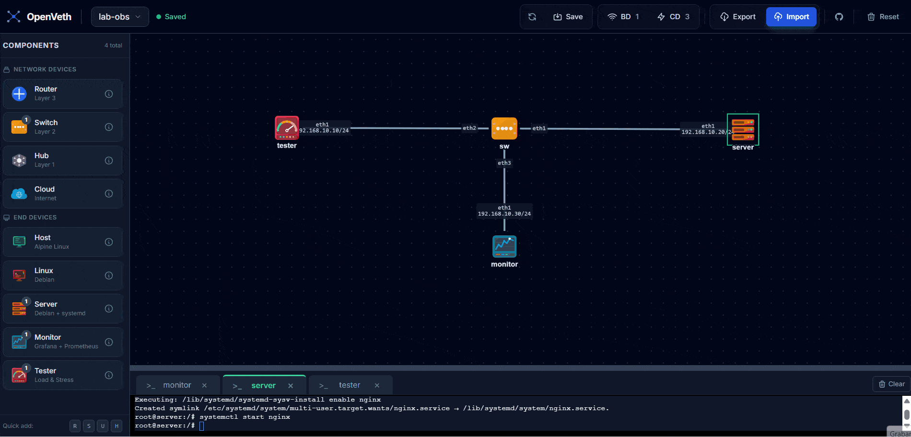

# Usage guide

[Back to README](../README.md)

## Cloud gateway

The **CLOUD** node acts as a NAT gateway. When created, it automatically enables IP forwarding and sets up masquerade rules so any connected lab node can reach real internet.

**Example topology:**
```
HOST ── ROUTER ── CLOUD ── Internet
```

**Configuration steps:**

On **CLOUD** (terminal):
```bash
ip addr add 10.0.2.2/30 dev eth0
ip link set eth0 up
ip route add 10.0.1.0/30 via 10.0.2.1   # return route per lab subnet
```

On **ROUTER** (terminal):
```bash
ip addr add 10.0.1.1/30 dev eth0
ip addr add 10.0.2.1/30 dev eth1
ip link set eth0 up && ip link set eth1 up
ip route add default via 10.0.2.2
sysctl -w net.ipv4.ip_forward=1
```

On **HOST** (terminal):
```bash
ip addr add 10.0.1.2/30 dev eth0
ip link set eth0 up
ip route add default via 10.0.1.1
ping 8.8.8.8   # should work
```

## Topology YAML format

Export and import full lab configurations, including IP addresses and static routes:

```yaml
name: First Lab
nodes:
  - name: R1
    type: router
    x: 200
    y: 150
    interfaces:
      - interface: eth0
        address: 10.0.0.1/24
  - name: PC1
    type: host
    x: 400
    y: 150
    interfaces:
      - interface: eth0
        address: 10.0.0.2/24
    routes:
      - dst: 0.0.0.0/0
        gateway: 10.0.0.1
        dev: eth0
links:
  - source: R1
    target: PC1
    source_int: eth0
    target_int: eth0
    enabled: true
```

Import applies the listed IP addresses and static routes and persists them. Choose a new laboratory or explicitly replace the current laboratory in the import dialog. YAML does not include installed packages, service data, or filesystem snapshots.

## Startup and troubleshooting

Run commands from the repository root. The launchers reuse local images, download missing ones, and build locally if a download fails. Building requires access to the image repositories and package sources used by each Dockerfile.

### Linux startup options

```bash
make up UPDATE_IMAGES=1       # Attempt to update existing node images
make up STARTUP_TIMEOUT=300   # Increase the startup readiness timeout
make pull-images             # Prepare or update node images separately
make test-startup            # Run isolated launcher regression tests
```

### Windows startup options

```powershell
.\start.bat -UpdateImages
.\start.bat -NoPause
.\start.bat -StartupTimeoutSeconds 300
powershell.exe -NoProfile -ExecutionPolicy Bypass -File scripts/start-windows.tests.ps1
```

### Common problems

| Symptom | Check |
|---------|-------|
| Docker is unavailable | Start the daemon or Docker Desktop; confirm `docker info` succeeds |
| Windows launcher rejects the backend | Enable Docker Desktop's WSL2 backend and Linux containers; confirm WSL2 can start |
| Startup is slow | Allow initial image downloads/builds to complete; increase the readiness timeout if needed |
| Browser cannot connect | Use the URL printed by the launcher; inspect published ports with `docker compose ps` |
| Services do not become ready | Inspect `docker compose logs --tail=100`; the launchers also print logs when startup fails |
| Ports conflict | Stop the stack, run `make reset-ports` on Linux, and start again; this removes `.env`, so preserve custom settings first |
| Position save or lab operation fails | Read the persistent error in the UI and retry; do not assume an action succeeded because the canvas changed |
| Event connection drops during activation | Reconnect events; the UI queries the matching operation result. If completion remains unknown, reload and inspect the backend logs |

Port detection preserves unrelated `.env` settings during normal startup. `make reset-ports` explicitly deletes the file.

### Maintenance commands

```bash
make help          # Available targets
make status        # Published ports and container status
make logs          # Follow application logs
make down          # Stop the Compose stack
```

`make clean` removes OpenVeth images, snapshots, and build cache. `make nuke` additionally removes containers and database state. These are destructive maintenance operations, not normal shutdown commands. Preserve data you need before using them.

On Windows, use `docker compose ps`, `docker compose logs`, and `docker compose down` for the corresponding stack operations.

## Observability

The Monitor node starts Grafana and Prometheus and includes snmp_exporter. Other exporter binaries are available under `/opt/exporters/`; copy the appropriate binary to a target node, configure it, and add the target to Prometheus.

Examples include node_exporter for Linux metrics, nginx/apache exporters for web servers, and frr_exporter for routing metrics. Switch SNMP metrics can be collected through snmp_exporter. Loki is installed but disabled by default; enable it with `systemctl enable loki --now` when a lab needs it.

Dashboards and monitoring targets are part of the exercise rather than automatically generated for every topology.



The Zabbix node includes its server, web frontend, database, and Agent 2. Open the web UI from the properties panel. Configure hosts, templates, agents on target nodes, or SNMP endpoints according to the lab. Installing the Zabbix node does not automatically enroll the rest of the topology.

## Failure exercises

Right-click a link and choose **Disable Link** to bring its interfaces down while retaining the connection in the topology. Re-enable it to test recovery.

Use **Power off** on a node to stop its container. The backend observes Docker lifecycle events, including shutdown initiated from inside a node, and updates the UI. A stopped node affects all of its services and interfaces; a disabled link affects the selected connection.

The broadcast and collision overlays describe the topology's teaching model. They do not emulate physical shared Ethernet media. Visual traceroute resolves measured hops to lab nodes where possible.
